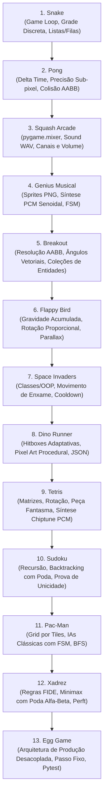

# Jogos Educativos em Python (Pygame-CE)

Coleção de 13 jogos didáticos desenvolvidos em **Python 3** com a biblioteca **pygame-ce** (Community Edition), concebidos como material de apoio pedagógico para o ensino de programação, estruturas de dados, algoritmos, matemática para jogos e arquitetura de software.

Cada projeto foi desenhado para expor conceitos essenciais de desenvolvimento de software em código legível, didático e pronto para execução e modificação pelos estudantes em sala de aula ou laboratório.

---

## 1. Instalação e Pré-requisitos

O único pré-requisito externo comum a todos os jogos é a versão comunitária do Pygame (**pygame-ce**), importada no código como `pygame`.

### Instalação no ambiente do usuário / global do sistema

```bash
python3 -m pip install --user --break-system-packages pygame-ce
```

### Verificação da instalação

Execute o comando abaixo no terminal para confirmar que a biblioteca está instalada e verificar a versão ativa:

```bash
python3 -c "import pygame; print(pygame.version.ver)"
```

A saída esperada deve exibir a versão do pygame-ce (ex.: `2.5.8` ou superior).

---

## 2. Tabela-Resumo dos Jogos

| Jogo | Nível Didático | Conceitos Principais | Comando de Execução | Aula em Vídeo |
|---|---|---|---|---|
| **Snake** | Iniciante | Game loop, grid discreto, listas/filas, colisão de borda/corpo | `cd snake && python3 snake_completo.py` | [roteiro](snake/docs/roteiro.md) · [partes](snake/partes/) |
| **Pong** | Iniciante | Delta time, física contínua, reflexão vetorial, colisão AABB, IA reativa | `cd pong && python3 pong.py` | [roteiro](pong/docs/roteiro.md) · [partes](pong/partes/) |
| **Squash Arcade** | Iniciante / Intermediário | Efeitos sonoros com `pygame.mixer` (`pre_init`, `Sound` com WAVs de `sons/`, canais `Channel` e volume por canal, mudo com `M`), delta time, ângulo de rebatida proporcional | `cd squash-arcade && python3 squash.py` | [roteiro](squash-arcade/docs/roteiro.md) · [partes](squash-arcade/partes/) |
| **Genius Musical** | Iniciante / Intermediário | Sprites PNG (`image.load`, `convert_alpha`, `smoothscale`, `blit`), retângulos clicáveis, síntese PCM senoidal com `array('h')` e envelope, máquina de estados com `dt` | `cd genius-musical && python3 main.py` | [roteiro](genius-musical/docs/roteiro.md) · [partes](genius-musical/partes/) |
| **Breakout** | Iniciante / Intermediário | Resolução AABB por menor sobreposição, desvio angular, lista de entidades | `cd breakout && python3 breakout.py` | [roteiro](breakout/docs/roteiro.md) · [partes](breakout/partes/) |
| **Flappy Bird** | Intermediário | Gravidade contínua, impulso vertical, rotação angular, reciclagem de canos, parallax | `cd flappy-bird && python3 main.py` | — |
| **Space Invaders** | Intermediário | Classes/OOP, movimento de enxame sincronizado, cooldown, escudos destrutíveis | `cd space-invaders && python3 space_invaders.py` | — |
| **Dino Runner** | Intermediário | Endless runner, hitboxes dinâmicas (agachar), pixel art e áudio procedurais, JSON | `cd dino-runner && python3 main.py` | — |
| **Tetris** | Intermediário / Avançado | Matrizes, rotação de blocos, ghost piece, retenção (HOLD), sintetizador chiptune PCM | `cd tetris && python3 tetris.py` | — |
| **Sudoku** | Avançado | Recursão e backtracking, matriz 9×9, prova de unicidade de solução, dicas | `cd sudoku && python3 main.py` | — |
| **Pac-Man** | Avançado | Grid por tiles, encruzilhadas, 4 IAs originais (Chase/Scatter/Frightened), BFS | `cd pac-man && python3 main.py` | — |
| **Xadrez** | Avançado | Regras FIDE (roque, en passant, promoção), Minimax com poda Alfa-Beta, perft | `cd xadrez && python3 main.py` | — |
| **Egg Game** | Avançado | Arquitetura modular desacoplada, passo fixo (fixed timestep), one-way collision, testes pytest | `cd egg-game && python3 main.py` | — |


---

## 3. Guia Detalhado por Jogo

---

### 3.1. Snake (`snake`)

> 🎬 **Aula em vídeo:** roteiro falado em [`snake/docs/roteiro.md`](snake/docs/roteiro.md) e código passo a passo (5 partes executáveis) em [`snake/partes/`](snake/partes/).

#### O que é
O clássico jogo da cobrinha implementado em grade discreta 2D. O repositório oferece dois arquivos: `snake.py` (código sequencial introdutório, ideal para as primeiras aulas) e `snake_completo.py` (gabarito modularizado em 14 etapas didáticas).

#### O que ensina (conceitos reais no código)
* **Estrutura de dados para corpo em grade**: a cobra é modelada como uma lista de pares de coordenadas `[x, y]`. A movimentação ocorre inserindo a nova cabeça no índice zero (`cobra.insert(0, nova_cabeca)`) e removendo a cauda (`cobra.pop()`). Quando a comida é ingerida, o `pop()` é omitido, aumentando o comprimento.
* **Grid discreto e quantização**: todas as posições são alinhadas em múltiplos de `TAMANHO = 20`, gerando coordenadas de comida com `random.randrange(0, LARGURA, TAMANHO)` em `gerar_comida()`.
* **Proteção contra inversão de 180°**: validação de entrada antes de aplicar velocidade, impedindo que a cobra inverta para o sentido oposto no mesmo eixo (`velocidade_y == 0` para comandos verticais e `velocidade_x == 0` para comandos horizontais).
* **Colisão discreta e fatiamento (slicing)**: colisão com bordas por checagem de limites e detecção de auto-colisão elegante via operador de pertencimento e fatiamento (`nova_cabeca in cobra[1:]`).
* **Dificuldade progressiva**: incremento dinâmico da taxa de quadros a cada fruta consumida (`velocidade += 0.5`, alimentando `relogio.tick(velocidade)`).
* **Modularização em funções**: em `snake_completo.py`, decomposição funcional em `gerar_comida()`, `desenhar_cobra()`, `desenhar_comida()`, `desenhar_pontos()` e `game_over()`.

#### Controles
* **Mudar direção**: Setas direcionais `↑`, `↓`, `←`, `→`
* **Sair**: Fechar a janela

#### Como rodar
```bash
cd snake
python3 snake_completo.py
```
*(Para acompanhar a versão sequencial introdutória: `python3 snake.py`)*

#### Exercícios e extensões pedagógicas
1. **Evitar spawn sobre o corpo**: modifique `gerar_comida()` com um laço de repetição que continue sorteando posições caso a coordenada coincida com qualquer bloco de `cobra`.
2. **Obstáculos fixos**: adicione uma lista de retângulos representando muros no centro do tabuleiro e trate a colisão da cabeça contra esses blocos.
3. **Frutas com pontuação e tempo especiais**: crie um item bônus que surge a cada 5 comidas comuns e desaparece após 7 segundos.

---

### 3.2. Pong (`pong`)

> 🎬 **Aula em vídeo:** roteiro falado em [`pong/docs/roteiro.md`](pong/docs/roteiro.md) e código passo a passo (5 partes executáveis) em [`pong/partes/`](pong/partes/).

#### O que é
A recriação do clássico inaugural dos videogames arcade: duas raquetes rebatem uma bola na tela até que um dos lados alcance 5 pontos. Oferece opção para 1 jogador contra IA reativa ou 2 jogadores humanos locais.

#### O que ensina (conceitos reais no código)
* **Física contínua com Delta Time**: movimentação baseada no tempo real decorrido entre quadros (`dt = relogio.tick(FPS) / 1000`).
* **Coordenadas flutuantes sub-pixel**: rastreamento contínuo em float (`bx, by = float(bola.x), float(bola.y)`) com sincronização a cada quadro para o `pygame.Rect` (`bola.topleft = (round(bx), round(by))`), garantindo deslocamento suave mesmo em variações de taxa de atualização.
* **Colisão AABB e reflexão com reposicionamento**: rebate a bola invertendo a velocidade horizontal (`vx = -vx`) e reposiciona imediatamente a borda da bola na face da raquete (`bx = esquerda.right` ou `bx = direita.left - bola.width`), eliminando o bug de "bola presa" dentro da raquete.
* **Aceleração progressiva**: multiplicação da velocidade escalar da bola a cada rebatida bem-sucedida (`vx *= 1.05`).
* **Restrição de tela nativa**: contenção das raquetes dentro dos limites da janela usando o método nativo do Pygame `r.clamp_ip(tela.get_rect())`.
* **IA reativa com limite de velocidade**: função `mover_ia(r, dt)` persegue a coordenada `bola.centery` com passo proporcional `VEL_RAQUETE * 0.75 * dt` e margem morta de tolerância (10 px), permitindo que a IA seja derrotável.

#### Controles
* **Raquete esquerda (Jogador 1)**: Teclas `W` (sobe) e `S` (desce)
* **Raquete direita (Jogador 2)**: Setas `↑` (sobe) e `↓` (desce)
* **Modo contra IA (1 jogador)**: Tecla `1`
* **Modo 2 jogadores**: Tecla `2`
* **Reiniciar partida após vitória**: Tecla `R`

#### Como rodar
```bash
cd pong
python3 pong.py
```

#### Exercícios e extensões pedagógicas
1. **Ângulo de ricochete proporcional**: calcule a distância entre o ponto de contato da bola e o centro da raquete para variar o vetor vertical `vy` (semelhante à mecânica do Breakout).
2. **Efeitos sonoros procedurais**: implemente bipes de colisão e som de ponto sintetizados via `pygame.mixer.Sound`.
3. **IA preditiva**: em vez de apenas acompanhar a coordenada `centery` da bola, faça a IA calcular onde a bola atingirá a linha de fundo considerando as quinas do teto e chão.

---

### 3.3. Squash Arcade (`squash-arcade`)

> 🎬 **Aula em vídeo:** roteiro falado em [`squash-arcade/docs/roteiro.md`](squash-arcade/docs/roteiro.md) e código passo a passo (5 partes executáveis) em [`squash-arcade/partes/`](squash-arcade/partes/).

#### O que é
Variação para um jogador do Pong em uma quadra fechada: a bola rebate nas paredes laterais e no teto, e o jogador controla uma raquete inferior para impedir que ela atravesse o piso. Cada rebatida vale 10 pontos (com bônus de 25 a cada cinco rebatidas) e há 3 vidas. Serve de ponte entre Pong e Breakout, com foco em **adicionar som ao jogo**.

#### O que ensina (conceitos reais no código)
* **Inicialização do mixer**: `pygame.mixer.pre_init(44100, -16, 1, 512)` antes de `pygame.init()`, configurando taxa de amostragem, formato, mono e buffer pequeno para baixa latência.
* **Carregamento de efeitos a partir de arquivos WAV**: a classe `Audio` lê os arquivos de `sons/` (`parede.wav`, `raquete.wav`, `ponto.wav`, `vida.wav`, `fim.wav`) com `pygame.mixer.Sound(...)`, mapeados no dicionário `SONS`. Os sons **não são sintetizados** no código.
* **Canais dedicados**: `pygame.mixer.set_num_channels(8)` e, em `tocar()`, `pygame.mixer.Channel(0)` para colisões frequentes (parede/raquete) e `Channel(1)` para pontos e avisos, evitando que um bipe de parede corte o som de vida perdida.
* **Volume por canal**: `canal.set_volume(0.30)` para colisões e `0.56` para eventos importantes.
* **Mudo e tolerância a falhas**: `alternar()` liga/desliga o som (tecla `M`) e chama `pygame.mixer.stop()`; se `pygame.mixer.get_init()` falhar ou um WAV não carregar, o jogo segue sem áudio, apenas avisando no terminal.
* **Revisão de Pong e preparação para Breakout**: delta time (`dt` limitado a 0,033 s), reflexão nas paredes, detecção da bola cruzando a face superior da raquete e ângulo de rebatida proporcional ao ponto de contato (até 65°), com aceleração progressiva até `VELOCIDADE_MAXIMA`.

#### Controles
* **Mover a raquete**: Setas `←` / `→` ou teclas `A` / `D`
* **Iniciar / próxima bola / continuar**: `Espaço` ou `Enter`
* **Pausar / retomar**: Tecla `P`
* **Reiniciar**: Tecla `R`
* **Ligar/desligar som**: Tecla `M`

#### Como rodar
```bash
cd squash-arcade
python3 squash.py
```
> Mantenha a pasta `sons/` ao lado de `squash.py`.

#### Exercícios e extensões pedagógicas
1. **Som que depende do contato**: toque um WAV agudo ou grave conforme a bola atinja a ponta ou o centro da raquete.
2. **Controle de volume**: adicione teclas (por exemplo `+` e `-`) que ajustem o volume dos canais e mostre o nível atual no rodapé.
3. **Música de fundo**: use `pygame.mixer.music` para tocar uma trilha em loop, independente dos canais de efeitos, e faça a tecla `M` silenciá-la também.

---

### 3.4. Genius Musical (`genius-musical`)

> 🎬 **Aula em vídeo:** roteiro falado em [`genius-musical/docs/roteiro.md`](genius-musical/docs/roteiro.md) e código passo a passo (5 partes executáveis) em [`genius-musical/partes/`](genius-musical/partes/).

#### O que é
Jogo de memória audiovisual inspirado no *Simon*: quatro elementos flat (Fogo, Água, Terra e Ar) formam uma sequência crescente de notas. O jogo demonstra a sequência iluminando cada cartão e tocando a frequência correspondente; o jogador deve repeti-la com o mouse ou as teclas 1–4. Introduz **carregamento de sprites PNG** e **síntese sonora por senoide PCM**, após Squash Arcade (áudio via WAV) e antes de Breakout.

#### O que ensina (conceitos reais no código)
* **Carregamento de imagens com transparência**: `pygame.image.load(...).convert_alpha()`, redimensionamento com `pygame.transform.smoothscale()` e composição via `Surface.blit()` dos ícones flat sobre cartões desenhados com `pygame.draw.rect`.
* **Regiões clicáveis**: retângulos distintos em grade 2×2; clique e teclas 1–4 percorrem a mesma rotina `selecionar(elemento)`.
* **Síntese PCM de senoides**: geração em memória com `math.sin`, `array('h')` e envelope de ataque/liberação; reprodução com `pygame.mixer.Sound(buffer=...)` após `mixer.pre_init` antes de `pygame.init()`.
* **Máquina de estados com `dt`**: estados `MENU → DEMONSTRANDO → ENTRADA → FEEDBACK → DEMONSTRANDO` (erro → `FIM`; `PAUSADO` preserva cronômetros); timers sem `time.sleep()`.
* **Sequência acumulativa**: a lista de notas cresce em uma unidade por rodada vencida, sem regenerar o prefixo.

#### Controles
* **Selecionar elemento**: clique no cartão ou teclas `1` (Fogo), `2` (Água), `3` (Terra), `4` (Ar)
* **Iniciar / reiniciar**: `Enter`
* **Pausar / retomar**: `P` ou `Esc`
* **Ligar/desligar som**: `M`

#### Como rodar
```bash
cd genius-musical
python3 main.py
```
> Mantenha a pasta `assets/imagens/` ao lado de `main.py`. Testes: `pytest testes/`.

#### Exercícios e extensões pedagógicas
1. **Modo só visual / só auditivo**: durante a demonstração, omita o som ou o destaque visual e compare a dificuldade.
2. **Timbre alternativo**: gere buffers com onda quadrada ou triangular (mesma frequência) e alterne com uma tecla.
3. **Escala de sete notas**: amplie de quatro elementos para a escala diatônica completa, ajustando grade e rótulos.

---

### 3.5. Breakout (`breakout`)

> 🎬 **Aula em vídeo:** roteiro falado em [`breakout/docs/roteiro.md`](breakout/docs/roteiro.md) e código passo a passo (5 partes executáveis) em [`breakout/partes/`](breakout/partes/).

#### O que é
Evolução direta do Pong onde a bola é controlada por uma raquete inferior e deve rebater contra uma formação de tijolos coloridos no topo da tela, administrando vidas limitadas e superando tijolos de diferentes resistências.

#### O que ensina (conceitos reais no código)
* **Resolução precisa de colisão AABB por menor sobreposição**: função `rebater_no_tijolo(r)` determina se a colisão ocorreu no topo/base ou nas laterais comparando `sobre_x` contra `sobre_y`, desfaz a penetração e inverte somente o eixo correspondente (`vx = -vx` ou `vy = -vy`).
* **Pesquisa de colisão em lote**: uso de `bola.collidelist([t["rect"] for t in tijolos])` para identificar instantaneamente o índice do tijolo impactado.
* **Ângulo de rebatida dinâmico na raquete**: cálculo do desvio normalizado `desvio = (bola.centerx - raquete.centerx) / (raquete.width / 2)` (intervalo `-1.0` a `1.0`), redistribuindo as componentes horizontal e vertical conservando a magnitude escalar vetorial com aceleração progressiva limitada (`min(..., VEL_BOLA * 1.8)`).
* **Entidades e propriedades em dicionários**: tijolos modelados contendo atributos `rect`, `cor` e `vida` (tijolos da fileira superior aguentam 2 impactos e exibem contorno especial enquanto intactos).
* **Máquina de estados**: controle de fluxo pelos estados `"JOGANDO"`, `"GAME_OVER"` e `"VITORIA"`.

#### Controles
* **Mover raquete**: Setas `←` (esquerda) e `→` (direita)
* **Reiniciar partida (em Game Over ou Vitória)**: Tecla `R`

#### Como rodar
```bash
cd breakout
python3 breakout.py
```

#### Exercícios e extensões pedagógicas
1. **Power-ups colecionáveis**: faça certos tijolos liberarem cápsulas que descem pela tela e, ao serem apanhadas pela raquete, dobram sua largura ou adicionam uma segunda bola.
2. **Tijolos inquebráveis**: introduza tijolos cinzas com vida infinita que atuam como barreiras fixas de desafio geométrico.
3. **Múltiplas fases**: crie uma lista de padrões de tijolos carregados sequencialmente ao esvaziar a tela.

---

### 3.6. Flappy Bird (`flappy-bird`)

#### O que é
Adaptação em tela vertical (`400×600`) do fenômeno Flappy Bird: um pássaro animado deve voar através de aberturas entre canos verdes com alturas aleatórias, sofrendo ação de gravidade contínua e rotação angular dinâmica.

#### O que ensina (conceitos reais no código)
* **Gravidade newtoniana contínua e impulso**: a velocidade vertical é integrada a cada quadro em `atualizar()` por `bird_v += GRAVIDADE * (dt * 60)`, enquanto a função `flap()` zera a descida e aplica impulso ascendente instantâneo (`bird_v = FLAP_V = -8.0`).
* **Atitude e rotação angular proporcional**: a orientação do sprite é calculada dinamicamente a partir da velocidade vertical (`self.angulo = min(35.0, max(-80.0, -self.bird_v * 5.0))`), apontando o bico para cima ao bater asas e mergulhando em direção ao solo em queda livre.
* **Geração procedural e reciclagem de obstáculos**: classe `@dataclass Cano` modela obstáculos com centro do vão aleatório (`gap_y`), gerando retângulos independentes de colisão superior e inferior (`topo_rect` e `base_rect`) via `_novo_cano()`.
* **Colisão AABB**: checagem de colisão da caixa envolvente do pássaro contra canos, teto e linha do solo em `bird_rect().colliderect()`.
* **Ilusão de scroll e parallax**: deslocamento modular contínuo do chão em `self.chao_off = (self.chao_off + VEL_SCROLL * dt * 60) % 20`.
* **Animação procedural de asas**: batimento orgânico de asas calculado por função senoidal em `self.asa`.
* **Automação no modo demo**: método `_auto_flap()` monitora a altura do próximo cano para disparar pulos autônomos.

#### Controles
* **Bater asas / Pular**: Barra de Espaço (`K_SPACE`) ou Clique do mouse
* **Reiniciar partida após colisão**: Tecla `R`
* **Sair**: Tecla `ESC`

#### Como rodar
```bash
cd flappy-bird
python3 main.py
```
* **Flags disponíveis**:
  * `--demo`: ativa piloto automático (`_auto_flap()`) e grava capturas da partida em `prints/`.

#### Exercícios e extensões pedagógicas
1. **Medalhas de mérito**: adicione uma tela de premiação com medalhas de bronze, prata, ouro e platina conforme a pontuação final.
2. **Dificuldade adaptativa**: diminua gradualmente a abertura do vão (`VAO = 150`) e aumente a velocidade de rolagem à medida que o jogador acumula pontos.
3. **Sistema de partículas de penas**: emita pequenas partículas brancas que giram e caem quando o pássaro colide com os obstáculos.

---

### 3.7. Space Invaders (`space-invaders`)

#### O que é
Adaptação do clássico shooter espacial arcade: o jogador controla um canhão terrestre na base, dispara contra uma formação de invasores alienígenas que descem em bloco ritmado e busca abrigo atrás de bunkers defensivos destrutíveis.

#### O que ensina (conceitos reais no código)
* **Programação Orientada a Objetos (OOP)**: organização nas classes `Nave`, `Tiro` e `Formacao`.
* **Movimento de enxame sincronizado**: classe `Formacao` agrupa os invasores em deslocamento horizontal comum acumulado em `x_acum`. Quando qualquer invasor toca as margens da tela (`any(inv.left <= 10 or inv.right >= LARGURA - 10)`), toda a esquadrilha inverte de direção, desce um degrau (`inv.y += 18`) e tem sua velocidade escalada com teto de segurança (`self.dx = -max(-400, min(400, self.dx * 1.04))`).
* **Gerenciamento seguro de coleções dinâmicas**: destruição de projéteis e alvos realizada por filtragem em novas listas (`tiros_vivos`, `[inv for i, inv in enumerate(...) if i not in acertados]`) e iteração sobre cópias rasas (`lista[:]`), prevenindo falhas de mutação durante a iteração.
* **Cadência de tiro e cooldown**: temporizador `self.recarga -= dt` na nave impedindo spam contínuo de projéteis pelo jogador.
* **Bunkers destrutíveis em malha de micro-blocos**: função `criar_escudos()` constrói 4 bunkers formados por dezenas de pequenos retângulos de 10×10 px que são destruídos individualmente (`escudos.pop(j)`) ao colidir com tiros do jogador ou dos inimigos.
* **Progressão infinita de ondas**: eliminação de todos os invasores inicia uma nova onda (`onda += 1`) com velocidade inicial acrescida.

#### Controles
* **Mover a nave**: Setas `←` (esquerda) e `→` (direita)
* **Disparar canhão**: Barra de Espaço (`K_SPACE`)
* **Reiniciar partida (em Game Over ou Vitória)**: Tecla `R`

#### Como rodar
```bash
cd space-invaders
python3 space_invaders.py
```

#### Exercícios e extensões pedagógicas
1. **Nave-mãe bônus (UFO)**: faça uma nave vermelha cruzar o topo da tela esporadicamente em alta velocidade, concedendo pontuação alta ao ser atingida.
2. **Restrição de disparo inimigo**: restrinja o sorteio do invasor que atira (`random.choice`) apenas aos alienígenas que estiverem na linha de frente inferior de cada coluna.
3. **Animação de marcha em dois frames**: alterne o desenho dos invasores a cada passo horizontal para criar o clássico efeito de braços abrindo e fechando.

---

### 3.8. Dino Runner (`dino-runner`)

#### O que é
Endless runner inspirado no dinossauro do Google Chrome, concebido para demonstrar como criar um jogo completo em um único arquivo Python sem dependências externas de imagens ou áudios: toda a pixel art, os glifos de texto e os bipes de áudio são gerados dinamicamente via código. Oferece dois temas visuais completos: Colorido (com parallax e ciclo dia/noite) e Clássico (Chrome Dino cinza `#535353` sobre fundo branco).

#### O que ensina (conceitos reais no código)
* **Física de pulo e queda rápida adaptativa**: gravidade base (`GRAVIDADE = 1800.0 px/s²`, `IMPULSO_PULO = -740.0 px/s`) com gravidade reforçada ao pressionar a tecla para baixo no ar (`GRAVIDADE_QUEDA_RAPIDA = 3600.0 px/s²`) para respostas rápidas.
* **Hitboxes compostas e adaptativas por postura**: classe `Dinossauro` altera dinamicamente sua caixa de colisão entre postura ereta e agachada em `definir_abaixado()`, viabilizando a esquiva de pterodáctilos voando em meia altura.
* **Cenário em Parallax e Ciclo Dia/Noite**: classe `CenarioDeserto` orquestra camadas de montanhas distantes, dunas médias e solo com velocidades proporcionais; interpolação gradual de paleta em `interpolar_cor()` simulando passagem de dia para noite a cada 700 pontos.
* **Geração procedural com distanciamento seguro**: classe `GeradorObstaculos` instancia cactos solitários (`CactoSimples`), agrupamentos (`GrupoCactos`) e pterodáctilos (`Pterodactilo`) calculando intervalos baseados na velocidade progressiva (que sobe de 320 px/s até 620 px/s).
* **Pixel art e renderização procedural em código**: função `criar_superficie_pixel_art()` converte matrizes de caracteres de texto em `pygame.Surface`, desenhando todas as animações do dinossauro, cactos e pterodáctilos.
* **HUD pixelada com fonte customizada**: dicionário `GLIFOS_HUD_PIXEL` com matrizes 6×7 para desenhar a pontuação retrô (`HI 000000  000000`).
* **Sintetizador de áudio procedural**: classe `SintetizadorAudio` gera ondas em memória para sons de pulo, alerta de centenas e batida.
* **Persistência de recorde**: leitura e escrita resilientes de pontuação recorde em `recorde.json` com `pathlib.Path` e `json`.
* **Sistema de partículas de poeira**: classe `ParticulaPoeira` simula tufos de areia sob os pés do dinossauro ao correr e aterrissar.

#### Controles
* **Pular**: Barra de Espaço (`K_SPACE`) ou Seta para Cima (`K_UP`)
* **Agachar / Descer rápido no ar**: Seta para Baixo (`K_DOWN`)
* **Alternar tema visual (Colorido / Clássico)**: Tecla `T` (`K_t`)
* **Pausar / Retomar**: Teclas `P` ou `ESC`
* **Reiniciar partida após Game Over**: `Espaço`, `Seta ↑`, `R` ou `Enter`

#### Como rodar
```bash
cd dino-runner
python3 main.py
```
* **Flags disponíveis**:
  * `--demo`: executa piloto automático (< 12 s), demonstrando ambos os temas visuais e salvando 4 prints em `prints/` (`titulo.png`, `jogo.png`, `classico.png`, `gameover.png`).
  * `--classico`: inicia o jogo diretamente no tema clássico monocromático.

#### Exercícios e extensões pedagógicas
1. **Condições climáticas**: adicione tempestades de areia procedurais periódicas com vento e partículas horizontais que afetem a visibilidade.
2. **Novos obstáculos dinâmicos**: crie meteoros ou pedras que rolem pela pista em direções oblíquas.
3. **Conquistas salvas em disco**: registre marcos de habilidade em `recorde.json` (ex: "Sobreviva 1000m sem pular", "Alcance 3000 pontos").

---

### 3.9. Tetris (`tetris`)

#### O que é
Implementação completa, colorida e moderna do clássico quebra-cabeça de empilhamento de blocos em grade de 10 colunas por 20 linhas. Possui rotação de matrizes, projeção fantasma (ghost piece), retenção de peça (HOLD), sintetizador de áudio chiptune procedural em memória, salvamento de recorde em JSON e compatibilidade com teclado, mouse e controles USB.

#### O que ensina (conceitos reais no código)
* **Separação entre regras de negócio e camada visual**: lógica matricial pura na classe `Tetris`, modelo da peça em `Peca`, gerenciamento de telas e eventos em `Interface` e sintetizadores em `AudioRetro` e `TrilhaChiptune`.
* **Manipulação e rotação de matrizes**: tetrominós definidos por matrizes booleanas 4×4 em `FORMATOS`, rotacionadas por transposição e inversão em `Peca.girar()` com validação de limites de campo ("wall kick" simplificado).
* **Peça fantasma (Ghost Piece)**: cálculo da projeção de queda em `Tetris.posicao_fantasma()` projetando a peça até o primeiro ponto de colisão inferior, renderizando a silhueta translúcida que apoia a decisão do jogador.
* **Mecânica de retenção (HOLD)**: método `Tetris.guardar()` que permite ao jogador reservar uma peça para momento oportuno, travando trocas consecutivas na mesma jogada.
* **Varredura e colapso de linhas**: método `Tetris.limpar_linhas()` verifica linhas completas na matriz do tabuleiro, calcula pontuações por combos clássicos (Single, Double, Triple, Tetris) e desaba a grade superior.
* **DAS (Delayed Auto Shift) / Autorepeat**: suavização de comandos repetidos ao segurar teclas direcionais em `Interface.repetir_movimento()`, com atraso inicial e cadência de repetição rápida.
* **Síntese de áudio procedural sem arquivos externos**: classes `AudioRetro` e `TrilhaChiptune` sintetizam ondas sonoras em memória convertidas para buffers PCM 16-bit com `array('h')`, gerando efeitos e música chiptune sem arquivos `.wav` ou `.mp3`.
* **Persistência de recordes**: métodos `carregar_recorde()` e `salvar_recorde()` gerenciando armazenamento em disco no caminho `~/.local/share/tetris/recorde.json` usando `pathlib.Path` e `json`.
* **Janela redimensionável**: suporte dinâmico ao evento `pygame.VIDEORESIZE`.

#### Controles
* **Mover peça lateralmente**: Setas `←` / `→` ou teclas `A` / `D`
* **Queda acelerada (Soft Drop)**: Seta `↓` ou tecla `S`
* **Girar peça**: Seta `↑` ou tecla `W`
* **Queda instantânea (Hard Drop)**: Barra de Espaço (`K_SPACE`)
* **Guardar peça na reserva (HOLD)**: Tecla `C`, `Shift Esquerdo` ou `Shift Direito`
* **Iniciar / Retomar partida**: Tecla `Enter`
* **Pausar / Retomar**: Teclas `P` ou `ESC`
* **Reiniciar partida**: Tecla `R`
* **Nível inicial (no menu inicial)**: Teclas numéricas `1` a `5`
* **Controles de som e música**: `M` (liga/desliga efeitos), `N` (liga/desliga música), `+`/`-` (volume da música), `[`/`]` (volume dos efeitos)
* **Mouse**: botões da interface e caixa de HOLD respondem ao clique

#### Como rodar
```bash
cd tetris
python3 tetris.py
```

#### Exercícios e extensões pedagógicas
1. **Gerador de peças "7-Bag"**: substitua o sorteio puramente aleatório pelo algoritmo oficial de sacola, onde todas as 7 peças são sorteadas sem repetição antes de reiniciar a sacola.
2. **Super Rotation System (SRS)**: implemente a tabela completa de 5 testes de deslocamento (offsets de wall-kick) para permitir giros em espaços apertados.
3. **Animação de limpeza**: insira uma animação de piscar ou dissolver blocos durante a eliminação de linhas antes de efetuar o colapso do tabuleiro.

---

### 3.10. Sudoku (`sudoku`)

#### O que é
Jogo de raciocínio numérico clássico em grade 9×9 dividida em 9 blocos 3×3, contendo gerador que assegura solução matematicamente única, 3 níveis de dificuldade, destaque visual de regras e conflitos em tempo real, sistema de dicas e resolução automática animada.

#### O que ensina (conceitos reais no código)
* **Recursão e Backtracking com poda**: algoritmos fundamentais em `encontra_vazio(g)` e `resolver(g)` para preenchimento sistemático e retorno quando uma restrição é violada.
* **Garantia matemática de unicidade**: função `contar_solucoes(g, limite=2)` interrompe a busca caso encontre mais de uma solução. O gerador em `gerar_puzzle(dificuldade)` escava células de uma grade completa gerada por `gerar_completo()` apenas enquanto a unicidade estrita for preservada.
* **Validação de restrições de Sudoku**: função `valido(g, r, c, n)` checa as três regras do jogo (sem repetições na linha, na coluna e no bloco 3×3 correspondente `3 * (r // 3), 3 * (c // 3)`).
* **Feedback de interface e conflitos**: função `conflitos(g, r, c)` detecta duplicidades e destaca números conflitantes em vermelho, iluminando em azul as células relacionadas na mesma linha, coluna e bloco.
* **Dificuldades parametrizadas**: controle da quantidade de furos pelo dicionário `DIFF_FUROS = {"facil": 35, "medio": 45, "dificil": 55}`.
* **Teste automatizado de integridade**: rotina `_teste_unicidade()` incorporada para certificar a robustez do algoritmo.

#### Controles
* **Selecionar célula**: Clique do mouse ou setas direcionais `↑`, `↓`, `←`, `→`
* **Preencher dígito**: Teclas numéricas `1` a `9`
* **Apagar número**: Teclas `0`, `Backspace` ou `Delete`
* **Dica**: Tecla `H` (preenche uma célula vazia com o valor correto da solução)
* **Novo jogo**: Tecla `N` (gera novo tabuleiro no mesmo nível)
* **Ciclar dificuldade**: Tecla `D` (alterna entre fácil, médio e difícil e gera novo tabuleiro)
* **Reiniciar puzzle atual**: Tecla `R` (limpa jogadas do jogador, mantendo as pistas iniciais)
* **Sair**: Tecla `ESC`

#### Como rodar
```bash
cd sudoku
python3 main.py
```
* **Flags disponíveis**:
  * `--demo`: executa auto-resolução visual passo a passo do algoritmo de backtracking e salva prints em `prints/`.
  * `--test`: executa a bateria de testes de unicidade gerando múltiplos tabuleiros para cada dificuldade e verificando a presença de solução única no console.

#### Exercícios e extensões pedagógicas
1. **Modo anotações ("pencil marks")**: permita que o jogador insira pequenos números de rascunho nas quinas das células para apoiar a dedução.
2. **Cronômetro e persistência**: adicione um contador de tempo na interface e registre o recorde de resolução mais rápida por dificuldade em JSON.
3. **Dicas explicativas**: modifique o sistema de dicas para explicar a técnica de dedução aplicada (ex.: "Único número possível nesta linha").

---

### 3.11. Pac-Man (`pac-man`)

#### O que é
Clone do consagrado arcade Pac-Man: o jogador navega por um labirinto consumindo bolinhas e pastilhas de força, cruza túneis laterais e enfrenta os 4 fantasmas com suas personalidades, inteligências artificiais e máquinas de estados originais.

#### O que ensina (conceitos reais no código)
* **Arquitetura de labirinto baseada em grade de tiles**: representação do mapa por matriz de strings em `MAPA_TXT`, convertida em malha de navegação pela função `parse_mapa()`.
* **Personalidades e algoritmos das 4 IAs originais**:
  * **Blinky** (Vermelho): perseguição direta à coordenada atual do Pac-Man (`px, py`).
  * **Pinky** (Rosa): emboscada, projetando seu alvo para 4 tiles à frente da direção atual do Pac-Man (`px + pac.dx * 4, py + pac.dy * 4`).
  * **Inky** (Ciano): ataque em pinça, dobrando o vetor formado entre a posição de Blinky e a frente do Pac-Man.
  * **Clyde** (Laranja): covarde, persegue enquanto a distância ao quadrado for superior a 64 tiles (`dist2 > 64`), dispersando para seu canto quando o Pac-Man se aproxima.
* **Máquina de estados dos inimigos**: alternância periódica entre modos `scatter` (dispersão para cantos fixos) e `chase` (perseguição ativa), modo `frightened` ativado temporariamente pelas power pellets (fantasmas azuis vulneráveis e lentos com alvos aleatórios) e modo `eyes` (apenas olhos retornando à casa central após serem comidos).
* **Navegação em encruzilhadas**: função `mover_fantasma()` toma decisões de rota no alinhamento central dos tiles (`tile_centro`), calculando a menor distância euclidiana ao quadrado para o alvo e proibindo inversões de marcha de 180° a menos que alcance um beco sem saída.
* **Túneis de teletransporte (wrapping)**: função `wrap()` reconectando as aberturas das bordas esquerda e direita do labirinto.
* **Busca em Largura (BFS)**: método `auto_piloto()` implementa BFS para guiar o Pac-Man de forma autônoma até a bolinha mais próxima no modo `--demo`.

#### Controles
* **Mover o Pac-Man**: Setas direcionais `↑`, `↓`, `←`, `→`
* **Reiniciar partida**: Tecla `R`
* **Sair**: Tecla `ESC`

#### Como rodar
```bash
cd pac-man
python3 main.py
```
* **Flags disponíveis**:
  * `--demo`: ativa o piloto automático autônomo baseado em BFS e salva screenshots da gameplay em `prints/`.

#### Exercícios e extensões pedagógicas
1. **Frutas bônus**: implemente o surgimento de frutas (cereja, morango) no centro do labirinto após o consumo de um percentual fixo de bolinhas.
2. **Pontuação multiplicativa de fantasmas**: atribua pontuação em progressão geométrica ao devorar múltiplos fantasmas na mesma pastilha (200, 400, 800, 1600 pontos).
3. **Efeitos sonoros procedurais**: sintetize os sons característicos de mastigação ("waka-waka") e a sirene de alarme de perseguição via código.

---

### 3.12. Xadrez (`xadrez`)

#### O que é
Implementação integral do jogo de xadrez com visual inspirado no chess.com (tabuleiro creme e verde, rótulos A–H e 1–8), peças desenhadas puramente por polígonos vetoriais, motor com todas as regras da FIDE e motor de IA baseado em Minimax com poda Alfa-Beta.

#### O que ensina (conceitos reais no código)
* **Representação de tabuleiro e regras oficiais FIDE**: classes `@dataclass` `Lance` e `Estado`, tabuleiro matricial 8×8, geração de lances pseudolegais em `geradores_pseudo()` e filtragem estrita de lances legais em `legais()` garantindo que o próprio rei não permaneça sob ataque.
* **Lances especiais**: Roque (maior e menor com checagem de casas atacadas no caminho em `roque`), captura En Passant (`ep`) com expiração em meio-lance e promoção automática a Dama (`promo`).
* **Reconhecimento de xeque, mate e afogamento**: detecção em `em_xeque()` e `atualizar_status()` verificando se a lista de lances legais está vazia com ou sem o rei atacado.
* **Inteligência Artificial (Minimax com Poda Alfa-Beta)**: função `minimax(est, depth, alpha, beta)` que avalia a árvore de decisões antecipando respostas do adversário, combinando contagem de material em `VALOR` com posicionamento estratégico em `avaliar()`.
* **Validação formal do motor via Perft**: função `perft(est, depth) -> int` que percorre recursivamente todos os nós da árvore de lances legais, técnica padrão utilizada em motores profissionais de xadrez para certificar a exatidão das regras contra tabelas canônicas.
* **Renderização vetorial com primitivas**: função `desenhar_peca()` desenha coroas, cruzes e cavalos combinando polígonos e círculos anti-aliasing sem necessidade de carregar imagens PNG externas.

#### Controles
* **Selecionar e mover peça**: Clique com o botão esquerdo do mouse na casa de origem e na casa de destino
* **Modo 2 jogadores locais**: Tecla `1`
* **Jogar de Brancas contra a IA**: Tecla `2`
* **Jogar de Pretas contra a IA**: Tecla `3`
* **Reiniciar partida**: Tecla `R`
* **Sair**: Tecla `ESC`

#### Como rodar
```bash
cd xadrez
python3 main.py
```
* **Flags disponíveis**:
  * `--demo`: executa partida autônoma de IA contra IA e salva capturas de tela em `prints/`.
  * `--perft <profundidade>`: executa o teste de desempenho e contagem de nós até a profundidade informada (ex: `python3 main.py --perft 3`).

#### Exercícios e extensões pedagógicas
1. **Modal de promoção de peão**: abra uma janela de escolha para o usuário optar entre Dama, Torre, Bispo ou Cavalo na promoção de peões.
2. **Tabela de transposição**: implemente um dicionário de estados visitados com hash Zobrist para evitar recalcular ramos idênticos da árvore no Minimax.
3. **Relógio de xadrez**: adicione contadores de tempo decrescentes para cada cor com suporte a incremento por lance.

---

### 3.13. Egg Game: De Volta ao Ninho (`egg-game`)

#### O que é
Jogo de aventura vertical em formato retrato (`720×1280`, proporção `9:16`). O jogador ajuda um ovo a saltar de cesta em cesta ao longo de uma árvore até alcançar o ninho familiar a 120 metros de altitude. A mecânica central é deliberadamente minimalista: **o jogador só tem um controle: pular** — o ovo não possui movimentação horizontal própria; todo o alinhamento espacial decorre do cálculo do momento exato em que as cestas móveis se cruzam.

#### O que ensina (conceitos reais no código)
* **Arquitetura modular em camadas desacopladas**: separação estrita entre o núcleo de simulação (`egg_game/core/`, 100% puro Python, sem nenhuma importação de Pygame ou SDL), o subsistema de renderização (`egg_game/render/`), o sintetizador de som (`egg_game/audio/`) e o orquestrador (`egg_game/app.py`).
* **Simulação física com passo fixo (Fixed Timestep)**: classe `WorldSimulation` em `egg_game/core/physics.py` utiliza delta time fixo desacoplado da taxa de exibição de vídeo (`FIXED_DT = 1/60`), acumulador de tempo e sub-steps, assegurando determinismo físico imune a variações de taxa de quadros.
* **Plataformas móveis e colisão One-Way**: classe `Platform` em `egg_game/core/platforms.py` gerencia cestas deslizantes (`slide`) e harmônicas (`oscillating`). O ovo atravessa a plataforma na subida (`vy < 0`) e atraca ao cruzar o topo na descida (`vy > 0`), viajando acoplado à cesta até o comando do próximo salto (sem pulo automático ao pousar).
* **Geração procedural determinística com prova de alcançabilidade**: classes `LevelGenerator` e `ReachabilityValidator` em `egg_game/core/generator.py` utilizam `seed` determinística e validam matematicamente que todas as transições entre cestas adjacentes possuem uma janela temporal de salto factível (`compute_timing_window`).
* **Câmera vertical com amortecimento suave**: classe `VerticalCamera` em `egg_game/core/camera.py` implementa smooth damping e restrição unidirecional (não retrocede quando o ovo cai).
* **Máquinas de estado estritas (FSM)**: enums `AppState` e `EggState` em `egg_game/core/states.py` modelando os estados da aplicação e do ciclo de vida do ovo (`IDLE`, `ASCENDING`, `DESCENDING`, `BROKEN`, `NESTED`).
* **Persistência resiliente a corrupção**: classe `SaveRepository` em `egg_game/core/score.py` lê e salva `save_data.json` com recuperação automática para valores padrão caso o arquivo seja danificado.
* **Testes unitários e de integração com Pytest**: suíte de testes em `tests/test_core.py` avaliando acoplamento horizontal com a cesta, impossibilidade de pulo duplo no ar, colisão one-way, invariância determinística de seeds e persistência de recorde.

#### Controles
> **Importante:** no gameplay, o controle é **apenas pular**!
* **Pular** (único comando de movimentação): Barra de Espaço (`K_SPACE`), Seta para Cima (`K_UP`) ou `W` (`K_w`), ou clique/toque com o mouse na área de jogo
* **Pausar / Retomar**: Teclas `ESC` ou `P`, ou botão `||` na interface
* **Navegação e confirmação em menus**: `Enter`, `Espaço`, `R` (reiniciar partida) ou clique nos botões

#### Como rodar
> **Atenção:** execute obrigatoriamente a partir de dentro do diretório `egg-game` para o carregamento correto dos assets:
```bash
cd egg-game
python3 main.py
```
* **Flags disponíveis**:
  * `--demo`: executa piloto automático baseado em cálculo de janela de alcance e salva 6 capturas em `prints/` (`titulo.png`, `modo.png`, `jogo.png`, `pausa.png`, `gameover.png`, `vitoria.png`).
  * `--seed <int>`: define a semente determinística do gerador procedural de cestas.
* **Executar os testes automatizados da suíte didática**:
```bash
cd egg-game
pytest -v
```

#### Exercícios e extensões pedagógicas
1. **Novos comportamentos de plataformas**: crie cestas frágeis que começam a rachar e desabam 1,5 segundos após o pouso do ovo.
2. **Vento lateral procedural**: adicione rajadas de vento variáveis que apliquem aceleração no eixo X sobre o ovo exclusivamente enquanto ele estiver no ar.
3. **Itens colecionáveis**: posicione sementes ou penas flutuantes nas janelas de salto entre cestas para pontuação adicional.

---

## 4. Ordem Sugerida de Estudo

Para turmas de programação, desenvolvimento de jogos ou usabilidade, recomenda-se a seguinte progressão didática, ordenada pela complexidade gradual dos conceitos de computação:



1. **Snake**: fundação do game loop, controle de taxa de quadros, eventos de teclado e representação de entidades em grade discreta usando listas como filas.
2. **Pong**: transição da grade discreta para física contínua no tempo (`dt`), vetores de velocidade, reflexão elástica e IA reativa simplificada.
3. **Squash Arcade**: mesma física contínua do Pong, agora com áudio: `pygame.mixer.pre_init`, efeitos `pygame.mixer.Sound` carregados de arquivos WAV, canais dedicados com volume próprio e opção de mudo — sem travar o game loop.
4. **Genius Musical**: sprites PNG com transparência (`load`/`convert_alpha`/`smoothscale`/`blit`), retângulos clicáveis em grade 2×2 e síntese de notas por senoide PCM em memória (`array('h')` + envelope), sincronizada a uma máquina de estados com `dt`.
5. **Breakout**: resolução avançada de colisões AABB (distinção entre bordas verticais e horizontais), rebatidas com conservação escalar e listas de blocos com estados de durabilidade.
6. **Flappy Bird**: aceleração gravitacional acumulada, cálculo de atitude angular por velocidade vertical, geração procedural infinita e efeito de parallax no solo.
7. **Space Invaders**: programação orientada a objetos (OOP), sincronização de enxame de inimigos, cadência de disparos (cooldown) e gerenciamento seguro de coleções dinâmicas de tiros.
8. **Dino Runner**: criação de jogos autossuficientes sem assets externos (pixel art e áudio procedural em código puro), hitboxes compostas para agachar e persistência de dados em JSON.
9. **Tetris**: computação matricial 2D, transformações lineares para rotação de peças, projeção de queda futura ("ghost piece"), delayed auto-shift (DAS) e síntese de áudio chiptune PCM em memória.
10. **Sudoku**: algoritmos clássicos de recursão e backtracking com poda, matrizes 9×9 e garantia matemática de unicidade de solução por contagem exaustiva.
11. **Pac-Man**: estruturas de dados para labirintos em tiles, pathfinding em encruzilhadas, inteligências relacionais com personalidades distintas e máquinas de estados finitos (FSM).
12. **Xadrez**: modelagem de regras complexas da FIDE (roque, en passant, promoção), teoria dos jogos com algoritmo Minimax, poda Alfa-Beta e validação formal de motor com perft.
13. **Egg Game**: engenharia de software e padrões de produção profissional: separação completa entre núcleo e apresentação, simulação em passo fixo (fixed timestep), colisão one-way e testes automatizados com `pytest`.


---

## 5. Smoke Test Headless (Validação sem Janela Gráfica)

Em ambientes de integração contínua (CI/CD), servidores remotos ou no laboratório da universidade, todos os jogos podem ser testados em modo "headless" (sem monitor físico nem dispositivo de áudio) utilizando os drivers virtuais `dummy` da biblioteca SDL.

### Comando individual de verificação

Para validar qualquer jogo individualmente por 5 segundos sem abrir janela:

```bash
SDL_VIDEODRIVER=dummy SDL_AUDIODRIVER=dummy timeout 5 python3 <arquivo_de_entrada>.py
```

### Bateria completa de testes em lote

Execute o script bash abaixo para checar automaticamente todos os 13 jogos da coleção:

```bash
for d in snake pong squash-arcade genius-musical breakout flappy-bird space-invaders dino-runner tetris sudoku pac-man xadrez egg-game; do
  entry="main.py"
  if [ "$d" = "snake" ]; then entry="snake_completo.py"; fi
  if [ "$d" = "pong" ]; then entry="pong.py"; fi
  if [ "$d" = "squash-arcade" ]; then entry="squash.py"; fi
  if [ "$d" = "breakout" ]; then entry="breakout.py"; fi
  if [ "$d" = "space-invaders" ]; then entry="space_invaders.py"; fi
  if [ "$d" = "tetris" ]; then entry="tetris.py"; fi

  echo -n "Testando $d ($entry)... "
  (cd "$d" && SDL_VIDEODRIVER=dummy SDL_AUDIODRIVER=dummy timeout 5 python3 "$entry" > /dev/null 2>&1)
  code=$?
  if [ $code -eq 124 ]; then
    echo "✓ OK (executou estavelmente até o timeout)"
  else
    echo "✗ Erro (código de saída: $code)"
  fi
done
```

> **Nota:** o código de saída `124` retornado pelo comando `timeout` confirma que o jogo iniciou, executou o game loop sem erros ou exceções e foi encerrado normalmente após o tempo estipulado.

---

## 6. Origem e Propósito Pedagógico

Esta coleção reúne jogos concebidos, adaptados e organizados como material de suporte para as aulas práticas das disciplinas de **Usabilidade**, **Interface Homem-Computador (IHC)** e **Desenvolvimento de Jogos** de cursos de graduação em Computação.

O foco central é didático: todos os códigos priorizam a legibilidade, a demonstração clara de conceitos algorítmicos essenciais e a autonomia dos estudantes, utilizando bibliotecas abertas e dispensando ferramentas proprietárias ou frameworks opacos.

---

## Aulas em vídeo (material das partes)

- **Snake** — código passo a passo em [`snake/partes/`](snake/partes/) e roteiro falado em [`snake/docs/roteiro.md`](snake/docs/roteiro.md).
- **Pong** — código passo a passo em [`pong/partes/`](pong/partes/) e roteiro falado em [`pong/docs/roteiro.md`](pong/docs/roteiro.md).
- **Squash Arcade** — código passo a passo em [`squash-arcade/partes/`](squash-arcade/partes/) e roteiro falado em [`squash-arcade/docs/roteiro.md`](squash-arcade/docs/roteiro.md).
- **Genius Musical** — código passo a passo em [`genius-musical/partes/`](genius-musical/partes/) e roteiro falado em [`genius-musical/docs/roteiro.md`](genius-musical/docs/roteiro.md).
- **Breakout** — código passo a passo em [`breakout/partes/`](breakout/partes/) e roteiro falado em [`breakout/docs/roteiro.md`](breakout/docs/roteiro.md).
