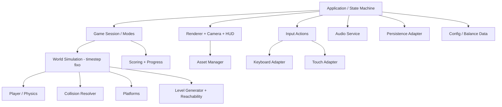

# PRD — Egg Game: De Volta ao Ninho

**Versão:** 1.0  
**Data:** 27/10/2026  
**Status:** Baseline proposta para implementação  
**Tipo:** Product Requirements Document (PRD)  
**Produto:** Jogo autoral 2D de plataforma vertical  
**Plataformas-alvo:** Desktop (primeira entrega); Android (alvo condicionado a spike de empacotamento)  
**Tecnologia inicial:** Python + Pygame-CE  
**Idioma inicial:** Português (Brasil)  
**Orientação de tela:** Retrato, proporção lógica 9:16  

> **Convenção documental:** elementos indicados como **[MVP]** são requisitos obrigatórios para a primeira versão jogável completa; **[V1]** representam a versão ampliada de lançamento; **[Futuro]** são possibilidades, não compromissos. Números de física, desempenho e balanceamento são valores iniciais de projeto, sujeitos a playtesting. O nome oficial é **Egg Game: De Volta ao Ninho**; inscrições “Egg Jump” em artes preliminares são placeholders e devem ser substituídas.

## 1. Resumo executivo

*Egg Game: De Volta ao Ninho* é um jogo single-player de precisão e reflexos. Um ovo caiu de uma árvore e precisa regressar ao próprio ninho. O jogador o conduz entre cestas suspensas, galhos e suportes improvisados, escalando um cenário vertical. O ovo salta automaticamente ao pousar: o comando principal é o movimento horizontal. Se o jogador errar e cair além da área recuperável, uma sequência cartunesca mostra a casca rachando e a gema se espalhando, seguida da opção de tentar novamente.

O produto combina regras acessíveis, animação expressiva e humor visual com sistemas tecnicamente interessantes para ensino de programação: gravidade, colisões unidirecionais, câmera vertical, geração de plataformas com garantia de alcançabilidade, sprites, máquinas de estados, persistência e abstração de entrada para desktop/mobile. A experiência deve ser compreensível em segundos, mas recompensar domínio do tempo e da trajetória.

## 2. Visão, posicionamento e princípios

**Visão:** transformar a vulnerabilidade de um ovo em um jogo vertical divertido, carismático e imediatamente reconhecível.

**Promessa ao jogador:** “Suba de cesta em cesta. Volte ao ninho. Só não quebre.”

**Pilares:** (P1) controle simples e responsivo; (P2) derrotas engraçadas, rápidas e não perturbadoras; (P3) desafios justos e progressivos; (P4) arte legível e consistente; (P5) partidas de curta duração com vontade de repetir.

**Público:** jogadores casuais que apreciam arcade de habilidade, inclusive estudantes e pessoas que jogam em sessões rápidas no celular. Classificação etária pretendida: livre ou equivalente, sujeita à avaliação da loja; a representação da gema não deve conter sangue, violência gráfica ou sofrimento realista.

**Diferenciais:** personagem formado quase inteiramente por forma e expressão facial; história com começo e conclusão sem perder o modo infinito; cestas com comportamentos próprios; câmera que revela a árvore e aproxima o protagonista de casa; mesma lógica de jogo testável fora da interface.

## 3. Metas de produto e métricas

| Identificador | Meta | Critério inicial |
|---|---|---|
| OBJ-01 | Controle compreensível | Em teste moderado, ao menos 80% dos participantes começam a jogar sem orientação oral adicional após tutorial de uma tela |
| OBJ-02 | Responsividade | Entrada aplicada no próximo passo de simulação; evitar atraso perceptível nos controles |
| OBJ-03 | Justiça | 100% das transições geradas em trajetórias críticas passam no validador de alcançabilidade |
| OBJ-04 | Robustez | 30 minutos de execução automatizada sem crash e sem crescimento de memória fora do limite definido nos testes |
| OBJ-05 | Ritmo | Uma partida inicial permite alcançar as primeiras cestas antes de introduzir plataformas complexas |
| OBJ-06 | Rejogabilidade | Recorde é persistido corretamente entre sessões e pode ser melhorado em modo Infinito |
| OBJ-07 | Compatibilidade futura | Lógica de mundo, regras, conteúdo e entradas não dependem de coordenadas físicas de monitor nem de teclado |

Os percentuais são **metas de aceitação propostas**, não resultados observados.

## 4. História e universo

O protagonista é um ovo pequeno, expressivo, sem nome obrigatório. Uma rajada de vento o derruba do ninho que divide com os demais ovos, localizado no topo de uma árvore grande e acolhedora. Ele cai sem se quebrar porque aterrissa acidentalmente em uma cesta com palha. Da cesta, percebe o ninho muito acima e começa a subir.

O universo usa lógica cartunesca: cestas aparecem entre galhos, algumas se movem, outras quebram e outras funcionam como trampolins. Pássaros e pequenos animais assistem à jornada como elementos cênicos. A expressão facial comunica medo, alegria, confiança, susto e alívio sem depender de texto. Ao chegar ao ninho no modo Aventura, o ovo reencontra a família e recebe uma pequena cena de comemoração. No modo Infinito, a árvore e as cestas se prolongam proceduralmente sem um destino final.

**Tom:** divertido, afetuoso e um pouco absurdo. **Restrições narrativas:** sem cutscenes longas, diálogos obrigatórios ou lore extenso no MVP. A comédia da derrota deve durar pouco e permitir reinício imediato.

## 5. Modos de jogo

### 5.1 Aventura [MVP]

Há início, progressão vertical e ponto final: o ninho está em uma altitude definida por configuração. O cenário mantém identidade de árvore única e introduz cestas progressivamente. O jogador conclui ao colidir com a área segura do ninho quando estiver descendo. A cena final exibe os ovos reunidos, a altura percorrida e a ação “Jogar novamente”. Não há sistema de vidas no MVP; cada queda encerra a tentativa e reinicia o percurso desde a primeira cesta.

**Parâmetro preliminar:** altitude do ninho equivalente a 120 unidades exibidas como “m” lúdicos, com escala 100 pixels de mundo = 1 m. A duração-alvo depende do balanceamento, não é garantia de tempo real.

### 5.2 Infinito [V1]

Sem ninho final; cestas são geradas em trechos verticais e a pontuação é dada pela maior altitude alcançada na tentativa. Ao morrer, mostra-se a altura atual, o recorde e o botão “Recomeçar”. A dificuldade cresce até um teto calibrado; nunca se gera um caminho obrigatório impossível. Pode ser selecionado no menu após introdução ou após a primeira vitória na Aventura (decisão de produto: **disponível desde o início** para reduzir fricção).

### 5.3 Fora de escopo do lançamento

Multiplayer, combate, níveis com editor, cadastro/login, economia de moedas, anúncios, compras no aplicativo, rankings online, backend, sincronização em nuvem, energia limitada e gacha. Todos ficam fora do MVP/V1.

## 6. Ciclo de gameplay

1. Abrir o aplicativo, escolher modo e iniciar.
2. Ver o ovo sobre uma cesta de partida.
3. Movimentá-lo horizontalmente durante cada salto.
4. Aterrissar sobre uma cesta válida; o próximo impulso é automático.
5. A câmera acompanha a subida e revela novas plataformas.
6. Ganhar altitude, evitar quedas e adaptar-se aos tipos de cesta.
7. Na Aventura, alcançar o ninho; no Infinito, superar o recorde.
8. Se cair, assistir à breve animação cartunesca e reiniciar com um único comando.

**Regra fundamental:** o salto não exige pressionar botão durante a partida. Não há pulo duplo nem mudança de direção vertical manual no MVP. Essa decisão diminui a carga cognitiva no celular e centraliza o desafio no posicionamento.

## 7. Personagem, comandos e física

### 7.1 Estados do personagem

`IDLE` (pousado), `ASCENDING` (subindo), `DESCENDING` (descendo), `LANDING` (contato breve), `DYING` (queda irreversível/animação), `DEAD` (aguarda reinício) e `CELEBRATING` (ninho alcançado). Estado de animação é derivado do estado físico, não deve duplicar a máquina de estados do jogo.

**Expressões:** neutro/contente em repouso; entusiasmo ou surpresa subindo; pânico descendo; contração no pouso; fragmentação da casca e gema no game over; alegria na vitória. Nenhuma expressão altera a hitbox.

### 7.2 Movimento

- O eixo horizontal usa entrada contínua à esquerda/direita; sem entrada, o ovo deixa de acelerar lateralmente ou reduz seu deslocamento conforme ajuste de controle.
- A gravidade sempre atua sobre o eixo vertical.
- O contato válido sobre o topo da cesta durante descida coloca o ovo na superfície e aplica impulso vertical negativo (para cima).
- Contatos laterais ou por baixo de cestas não ativam o salto; as cestas são plataformas *one-way*.
- O personagem não atravessa o topo de uma cesta ao cair; detecção considera posição anterior e atual para evitar *tunneling*.
- Não se pode obter vantagem significativa por aumentar ou reduzir FPS.

**Valores preliminares (coordenadas lógicas):** gravidade `2400 px/s²`, velocidade de salto `-950 px/s`, velocidade horizontal `380 px/s`, altura máxima teórica de salto aproximadamente `188 px`, passo fixo de simulação `1/120 s`. Velocidade e distâncias serão refinadas com playtesting. Não usar estes valores como constantes mágicas dispersas.

### 7.3 Controles

| Contexto | Desktop | Android |
|---|---|---|
| Mover à esquerda | `←` ou `A` | Segurar metade esquerda da área de jogo |
| Mover à direita | `→` ou `D` | Segurar metade direita da área de jogo |
| Iniciar/confirmar | `Enter` ou `Espaço` | Tocar no botão destacado |
| Pausar/voltar | `Esc` ou `P` | Botão de pausa; ação voltar do sistema tratada como pausa |
| Reiniciar após derrota | `R`, `Enter` ou botão | Botão grande “Tentar novamente” |

**Multitoque:** duas metades pressionadas simultaneamente devem resultar em estado neutro, evitando oscilação. A interface deve aceitar dedos de tamanhos diferentes, bordas arredondadas e áreas seguras (*safe areas*). Gestos de deslizar, acelerômetro e inclinação ficam para depois.

## 8. Sistemas de cestas e plataformas

| Tipo | Disponibilidade | Regra |
|---|---|---|
| Cesta fixa | MVP | Não se desloca, suporta pousos ilimitados |
| Cesta móvel | MVP | Oscila horizontalmente entre limites; velocidade e amplitude configuráveis |
| Cesta pequena | V1 | Menor área de pouso; mesma física básica |
| Cesta frágil | V1 | Rompe-se após o primeiro pouso; a ruptura visual ocorre depois do impulso automático |
| Cesta de impulso | V1 | Fornece salto mais alto que o normal, com sinalização visual clara |
| Cesta deslizante | Futuro | Altera a velocidade horizontal do personagem |
| Cesta falsa | Futuro | Não dá suporte e exige comunicação visual inconfundível |

**R-PLAT-01:** todas as cestas possuem `id`, tipo, posição/transformação, largura de contato, estado e parâmetros de movimento. **R-PLAT-02:** cestas móveis utilizam os mesmos limites de colisão percebidos na tela. **R-PLAT-03:** desaparecimentos e quebras não podem deixar a trajetória necessária impossível sem alternativa disponível. **R-PLAT-04:** o ninho final é uma plataforma segura especial, não um obstáculo comum.

O MVP jogável deve incluir **fixa + móvel**. Não é necessário implementar todos os tipos da arte conceitual logo na primeira entrega.

## 9. Geração de níveis e garantia de alcançabilidade

Na Aventura, usar uma sequência de trechos gerados a partir de uma *seed* fixa e parâmetros de progressão; o posicionamento final do ninho é determinado. No Infinito, usar gerador com *seed* da sessão e trechos renováveis. Cada trecho precisa conter **ao menos uma rota alcançável** entre a cesta de entrada e uma cesta de saída.

**Algoritmo proposto:**

1. Ler última cesta garantidamente alcançável (âncora).
2. Selecionar tipo de próxima cesta permitido para a faixa de dificuldade.
3. Amostrar deslocamento vertical e horizontal dentro de limites conservadores.
4. Simular ou resolver a trajetória do ovo no tempo de pouso descendente, considerando largura útil do personagem e intervalo de deslocamento das cestas móveis.
5. Aceitar candidato apenas se existir janela de aterrissagem suficiente; para cestas móveis, validar fases relevantes do movimento ou fornecer uma alternativa fixa.
6. Adicionar cestas secundárias opcionais para variedade, sem utilizá-las como única prova de caminho viável.
7. Repetir até completar o trecho; reamostrar em caso de falha.
8. Descartar trechos distantes abaixo da câmera, preservando margem para quedas recuperáveis.

**Configuração inicial:** diferença vertical entre cestas principais de aproximadamente `85–140 px`, ajustada à velocidade horizontal, altura máxima e largura das cestas. O valor exato não substitui a verificação geométrica. Não colocar duas plataformas de passagem obrigatória de forma que uma seja alcançável apenas com entrada impossível.

**Determinismo:** a mesma *seed*, mesmas entradas e mesma versão de regras devem reproduzir a mesma sequência de trechos, com tolerâncias de plataforma explicitadas. Gerar um *debug overlay* com hitboxes, rotas válidas, *seed* e FPS para testes.

## 10. Câmera, cenário e pontuação

### 10.1 Câmera

A câmera é vertical e acompanha o ovo somente durante a subida. Ao superar a linha de acompanhamento situada inicialmente em 40% da altura lógica da tela, o deslocamento de câmera impede que o personagem saia pelo topo. A câmera não precisa seguir a queda para baixo: a perda de contato visual do ovo ao ultrapassar a região inferior aciona o game over. O mundo continua em coordenadas independentes da tela.

**Transformação:** `screen_y = world_y - camera_y`. A elevação do personagem corresponde à diminuição de `world_y`; portanto `camera_y = min(camera_y, player_y - 0.40 * screen_h)` após a partida começar, com suavização apenas visual se não afetar colisões.

### 10.2 Altura e recorde

`max_height_px = max(0, start_world_y - min_world_y_reached)`. `height_m = floor(max_height_px / 100)`. Os “metros” são uma unidade ficcional de jogo, não uma medição física. O recorde corresponde ao maior `height_m` do respectivo modo. Recordes independentes para Aventura e Infinito. O jogador não perde pontuação ao descer.

### 10.3 Cenário e paralaxe

Camadas: céu e nuvens ao fundo, colinas/casas distantes, copa da árvore e vegetação média, tronco e galhos de primeiro plano, partículas opcionais. A árvore é o eixo visual da jornada. **Não** misturar cozinha, sótão e cenário de árvore como se fossem partes obrigatórias da mesma fase: imagens de interiores no atlas são conceitos alternativos ou futuros temas, não ambientes do modo Aventura inicial.

## 11. Progressão e balanceamento

| Faixa (altura lúdica) | Composição principal | Objetivo de sensação |
|---|---|---|
| 0–15 m | Cestas fixas amplas, intervalos curtos | Aprender a mover e pousar |
| 15–40 m | Fixas com primeira cesta móvel lenta | Compreender ritmo |
| 40–75 m | Mais móveis, combinações horizontais | Antecipação e precisão |
| 75–120 m | Caminho misto, maior exigência sem injustiça | Clímax e aproximação do ninho |
| Infinito após 120 m | Mistura procedural progressiva até teto seguro | Domínio, recordes, variedade |

Dificuldade não significa aumentar a gravidade aleatoriamente. Preferir mudanças visíveis e estáveis: frequência de cestas móveis, largura da superfície, deslocamento horizontal e ritmo de apresentação. Manter sempre alternativa viável. Um sistema de *spawn* por altura evita depender de FPS ou tempo de relógio para posicionar plataformas.

## 12. Telas, navegação e estados do aplicativo

**Estados globais:** `BOOT`, `MAIN_MENU`, `INTRO`, `PLAYING`, `PAUSED`, `DEATH_ANIMATION`, `GAME_OVER`, `VICTORY`, `SETTINGS` e `CREDITS` (créditos V1). A transição de pausa não atualiza física; ao retomar, zera-se a acumulação temporal para impedir saltos de simulação.

**Fluxo principal:** `BOOT → MAIN_MENU → [INTRO] → PLAYING → (PAUSED ↔ PLAYING) → (DEATH_ANIMATION → GAME_OVER → PLAYING | MAIN_MENU) ou (VICTORY → MAIN_MENU | PLAYING)`.

**Tela inicial [MVP]:** logo, personagem, árvore/ninho ao fundo, “Jogar Aventura”, “Modo Infinito” (quando habilitado), “Opções”, instruções mínimas. **Introdução [MVP]:** até três quadros opcionais e ignoráveis mostrando queda, cesta salvando o ovo e ninho distante. **Gameplay [MVP]:** altitude/recorde no topo e ícone de pausa, sem painéis que invadam a pista. **Pausa [MVP]:** continuar, reiniciar, som, voltar ao menu. **Game over [MVP]:** animação curta, altura, recorde, botão grande de reinício e menu. **Vitória [MVP]:** reencontro, conclusão, pontuação e opção de replay. **Configurações [MVP]:** música on/off, efeitos on/off, intensidade de movimento reduzida, redefinir dados com confirmação.

## 13. Requisitos UX, acessibilidade e usabilidade

- **UX-01:** tela inicial comunica o objetivo sem depender de texto longo.
- **UX-02:** botão principal de reinício sempre visível, com toque generoso.
- **UX-03:** feedback visual e sonoro imediato ao pouso e saltar.
- **UX-04:** sem sustos de tela ou flashes rápidos no game over; permitir reduzir partículas, tremor e movimento secundário.
- **UX-05:** contrastes suficientes no HUD; texto não deve ficar sobre nuvens claras sem contorno ou fundo adequado.
- **UX-06:** comandos e informações essenciais fora de recortes de câmera, entalhes e barras de navegação do Android.
- **UX-07:** não depender apenas de cor para distinguir cestas; silhueta, textura ou animação também comunicam tipo.
- **UX-08:** som desligável independentemente para música e efeitos.
- **UX-09:** nenhuma espera artificial entre derrota e novo início.
- **UX-10:** pausa automática quando o aplicativo perde foco ou vai para segundo plano, sem perda do recorde já consolidado.

## 14. Direção de arte e guia de assets

**Estilo oficial:** cartum 2D pintado digitalmente, casca creme/branca com volume suave, contornos escuros de aparência manual, bocas e olhos expressivos, cestas trançadas com palha, galhos e folhas em tons acolhedores, céu azul e iluminação suave. A estética original deriva das referências fotográficas de ovos com rostos desenhados, mas todos os sprites finais devem ser obras produzidas para o jogo, não recortes dessas fotografias.

**Paleta de referência (ajustável):** creme `#FFF0D6`, casca `#F8E8C8`, gema `#F5B83D`, palha `#DAA85F`, madeira `#805139`, folhagem `#5F993B`, céu `#74C6F0`, traço `#2A2521`.

### 14.1 Inventário de produção visual

| ID | Pacote | Entrega mínima | Formato de trabalho |
|---|---|---|---|
| ART-01 | Ovo idle | 4 quadros (piscar, neutro, confiante) | PNG RGBA, 128×128 por quadro |
| ART-02 | Ovo subindo | 4 quadros, expressões + squash/stretch | PNG RGBA, 128×128 |
| ART-03 | Ovo caindo | 4 quadros de susto | PNG RGBA, 128×128 |
| ART-04 | Pouso/impulso | 3 quadros de compressão/extensão | PNG RGBA, 128×128 |
| ART-05 | Quebra do ovo | 6–8 quadros até casca e gema, não gráfica | PNG RGBA, 192×192 ou maior, pivot consistente |
| ART-06 | Comemoração | 4 quadros do ovo feliz no ninho | PNG RGBA, 128×128 |
| ART-07 | Cesta fixa | 2–3 variações | PNG RGBA, fonte 256×128 |
| ART-08 | Cesta móvel | 1–2 variações + detalhes/cordas opcionais | PNG RGBA, fonte 256×128 |
| ART-09 | Cestas extras | Pequena, frágil e impulso para V1 | PNG RGBA, 256×128 |
| ART-10 | Ninho final | Ninho completo, familiares e versão de vitória | PNG RGBA, dimensão proporcional |
| ART-11 | Cenário | Céu, nuvens, colinas, tronco, galhos, folhagens | Camadas de PNG separadas, resolução compatível com 720×1280 |
| ART-12 | Elementos decorativos | Pássaro, esquilo, folhas, flores e partículas | PNG RGBA |
| ART-13 | UI | Logo definitivo, botões, painéis, ícones e tipografia licenciada | PNG RGBA/SVG fonte quando disponível |
| ART-14 | Efeitos | Poeira, estrelas, folhas e casca em movimento | PNG RGBA/atlas |
| ART-15 | Telas | Arte inicial, introdução, pausa, game over, vitória | Composições em camadas |

**Regras de exportação:** nomes estáveis, pixels transparentes realmente transparentes, nenhum título ou legenda dentro do sprite, quadros alinhados por *pivot*, margens suficientes para animações, escala e versão de origem registradas. Atlas/protótipos produzidos anteriormente **não** devem ser tratados automaticamente como sprites finais recortados de alta qualidade: exigir revisão humana de halos, recortes, consistência de expressão e ausência de componentes cortados.

**Padrão de arquivo:** `egg_idle_00.png`, `egg_jump_00.png`, `egg_fall_00.png`, `egg_death_00.png`, `basket_static_01.png`, `basket_moving_01.png`, `bg_sky.png`, `ui_btn_play.png`. Proporção lógica do projeto: `720×1280` (9:16); resolução física e escala são independentes.

## 15. Som e música

**Direção de áudio:** efeitos curtos, leves, elásticos e cartunescos, evitando trilha repetitiva cansativa. Inventário mínimo: salto (`jump`), pouso (`land`), impulso especial (`boost`, V1), quebra (`crack`), derrota (`game_over`), seleção (`ui_select`), vitória (`victory`) e loop musical (`bgm_loop`). Aceitar WAV/OGG conforme teste na plataforma; licenças registradas e nenhum uso de áudio sem direitos. Mixer isolado sob `AudioService`. Pausa de jogo pausa ou reduz música conforme configuração.

## 16. Arquitetura de software

### 16.1 Princípio

Separar **núcleo do jogo** de **adaptações de plataforma**. Física, colisões, pontuação, geração e regras de vitória não recebem eventos SDL diretamente nem desenham na tela. Implementações específicas tratam renderização, entrada, áudio, persistência e empacotamento. Dessa forma o desktop serve como ambiente de desenvolvimento; Android dependerá da viabilidade real de runtime/compilação.



### 16.2 Organização sugerida

```text
egg-game/
  pyproject.toml
  README.md
  docs/
    PRD.md
    GDD.md
    art-bible.md
    test-plan.md
  src/egg_game/
    __main__.py
    app.py
    config.py
    core/
      state_machine.py
      models.py
      world.py
      physics.py
      collisions.py
      level_generator.py
      reachability.py
      scoring.py
      progression.py
    systems/
      camera.py
      animation.py
      input_actions.py
      persistence.py
      audio.py
      asset_manager.py
    screens/
      menu.py
      intro.py
      gameplay.py
      pause.py
      game_over.py
      victory.py
      settings.py
    adapters/
      pygame_renderer.py
      desktop_input.py
      touch_input.py
      local_storage.py
  assets/
    characters/egg/
    platforms/
    nest/
    backgrounds/
    decorations/
    effects/
    ui/
    audio/
    fonts/
    manifest.json
  data/
    balance.json
    adventure.json
    localization/pt-BR.json
  tests/
    test_physics.py
    test_collisions.py
    test_generation.py
    test_camera.py
    test_scoring.py
    test_state_machine.py
    test_persistence.py
  scripts/
    validate_assets.py
    run_seed_tests.py
    build_desktop.py
    android_spike/
```

### 16.3 Contratos centrais

`GameSession`: recebe comandos sem conhecimento de teclado/toque, executa `step(dt)` e disponibiliza snapshot imutável/renderizável. `InputAdapter`: transforma teclado ou toque nas ações `MOVE_LEFT`, `MOVE_RIGHT`, `PAUSE`, `CONFIRM`, `RESTART`. `World`: contém posição, velocidade, plataformas e câmera, mas não lê tela física. `CollisionSystem`: resolve pouso descendente sobre superfícies. `LevelGenerator`: `generate_chunk(anchor, difficulty, seed)` e produz plataformas validadas. `ReachabilityValidator`: determina se existe trajetória válida para pelo menos uma próxima cesta. `SaveRepository`: salva/carrega recordes e preferências com versão de schema. `Renderer`: consome estado e sprites; nenhuma decisão de gameplay no renderizador.

O loop principal segue `poll_events → map_actions → fixed_update (0..n vezes) → interpolate/render → present`, com limite para atualizações acumuladas após travamento e logs de diagnóstico de atrasos. O teste automatizado de regras deve rodar sem abrir uma janela SDL.

### 16.4 Modelo de dados ilustrativo

```json
{
  "schema_version": 1,
  "mode": "adventure",
  "level_seed": 20261027,
  "balance_version": "1.0",
  "player": {"world_x": 360.0, "world_y": 0.0, "velocity_x": 0.0, "velocity_y": 0.0},
  "platforms": [
    {"id": "b-0001", "type": "fixed", "x": 300.0, "y": 64.0, "width": 180.0, "state": "active"},
    {"id": "b-0002", "type": "moving", "x": 410.0, "y": -60.0, "width": 170.0, "state": "active", "min_x": 290.0, "max_x": 510.0, "speed": 70.0}
  ]
}
```

Este JSON é exemplo de contrato lógico, não um arquivo de save obrigatório. Estados dinâmicos temporários podem viver apenas em memória. Valores salvos de recorde/preferência não dependem do número de frames.

## 17. Persistência e configuração

**Persistência [MVP]:** recorde por modo, volume/toggles, intensidade de efeitos, tutorial visto, versão do schema. Arquivo local JSON com escrita atômica (`arquivo.tmp` → flush → replace), leitura validada, defaults recuperáveis e tratamento de arquivo corrompido. Caminho deve vir de adaptador de armazenamento, nunca de diretório de instalação presumidamente gravável.

Exemplo:

```json
{
  "schema_version": 1,
  "records": {"adventure_height": 74, "endless_height": 136},
  "settings": {"music_enabled": true, "sfx_enabled": true, "reduced_motion": false},
  "tutorial_seen": true
}
```

Não coletar nome, telefone, localização, identificadores publicitários ou contas; dados permanecem locais no MVP/V1. Eventos de uso podem ser registrados **apenas em testes locais de desenvolvimento** e não devem sair do dispositivo sem decisão explícita de produto e política de privacidade.

## 18. Android e estratégia multiplataforma

**Prioridade:** desktop executável com Pygame-CE. **Objetivo secundário:** Android em retrato com entrada por toque e os mesmos conteúdos. O Pygame-CE usa SDL; porém empacotar o pacote Python/SDL para Android exige validar *recipes*, dependências nativas, compatibilidade de versão, orientação e desempenho real do aparelho. O suporte de `python-for-android` a aplicativos SDL2 não equivale a garantia de build imediato do `pygame-ce`.

**Spike Android obrigatório antes do compromisso de publicação:** compilar aplicativo mínimo que abre janela 9:16, desenha sprite PNG com alpha, recebe eventos de toque, toca um efeito, pausa ao perder foco, persiste recorde e gera APK instalável. Executar em pelo menos dois aparelhos Android representativos. Validar assinatura, versão de SDK e preparação para AAB apenas depois de viabilidade. Se falhar, manter desktop como entrega principal e decidir **explicitamente** entre (A) investir em recipe/port Android de Pygame-CE, ou (B) portar apresentação/execução para uma engine com suporte Android consolidado (como Godot), reaproveitando assets e especificações e reimplementando regras conforme necessário. Não prometer reutilização binária do código Python em outra engine.

**UX mobile:** 720×1280 lógicos, *scale-to-fit* sem distorção, suporte a resoluções reais diversas, áreas seguras e toque contínuo em metade esquerda/direita; botão de pausa no topo. Desktop também utiliza viewport 9:16 centralizado, com barras laterais se necessário.

**Não incluir no compromisso de lançamento:** anúncios, SDKs de rastreamento, compras, permissões extras, login ou backend.

## 19. Requisitos não funcionais

| ID | Requisito | Aceite |
|---|---|---|
| NFR-01 | FPS desktop | Alvo 60 FPS estáveis em equipamento de referência a definir; simulação independente do FPS |
| NFR-02 | FPS mobile | Alvo 60 FPS e piso operacional de 30 FPS em aparelhos do teste Android, sem alteração de trajetória |
| NFR-03 | Tempo de resposta | Ação mapeada antes do próximo passo fixo da simulação |
| NFR-04 | Estabilidade | Sessão automatizada de 30 min sem travamento/fuga crescente de recursos |
| NFR-05 | Escalabilidade visual | Nenhum recorte de HUD nem deformação em diferentes relações de aspecto |
| NFR-06 | Salvamento | Recorde sobrevive ao fechamento normal e interrupção da sessão; escrita atômica |
| NFR-07 | Robustez de recursos | Asset ausente aponta ID/arquivo e exibe erro controlado em build de desenvolvimento |
| NFR-08 | Portabilidade | Núcleo de regras não depende de SDL, resolução física ou filesystem relativo fixo |
| NFR-09 | Distribuição | Licenças de fontes, sons e arte documentadas, incluindo dependências externas |
| NFR-10 | Testabilidade | Testes unitários de movimento/colisão/geração/pontuação executam sem interface gráfica |

Metas de desempenho são requisitos candidatos que precisam de hardware de referência e medição formal; não alegações de resultados alcançados.

## 20. Backlog de funcionalidades priorizado

| ID | User story | Prioridade | Critério de aceite resumido |
|---|---|---|---|
| US-001 | Como jogador, quero entender a história rapidamente | MVP | Introdução ignorável até três cenas |
| US-002 | Quero mover o ovo com dois comandos | MVP | Entrada contínua e equivalente em teclado/toque |
| US-003 | Quero saltar ao pousar sem botão extra | MVP | Impulso automático exclusivamente em colisão descendente válida |
| US-004 | Quero enxergar as próximas cestas | MVP | Câmera sobe preservando campo de visão |
| US-005 | Quero encontrar cestas que se movem | MVP | Movimento previsível e colisão coerente |
| US-006 | Quero uma oportunidade justa de continuar | MVP | Geração nunca exige salto inalcançável |
| US-007 | Quero ver minha altura | MVP | HUD atualiza a maior altitude alcançada |
| US-008 | Quero um game over engraçado | MVP | Sequência de rachadura/gema não gráfica e reinício imediato |
| US-009 | Quero chegar ao ninho | MVP | Vitória ao pousar no ninho final |
| US-010 | Quero pausar e continuar | MVP | Física congelada, retomada sem salto temporal |
| US-011 | Quero conservar meus resultados | MVP | Recorde persistente e recuperável |
| US-012 | Quero jogar indefinidamente | V1 | Modo Infinito procedural e recorde independente |
| US-013 | Quero encontrar cestas especiais | V1 | Pequena, frágil e impulso com sinalização |
| US-014 | Quero áudio e opções acessíveis | MVP | Música/SFX independentes, opção reduzir movimento |
| US-015 | Quero instalar no Android | Condicional | Spike aprovado e APK funcional em aparelhos reais |

## 21. Critérios de aceite detalhados e testes

1. **ACE-01 / Salto:** quando a parte inferior do ovo cruza o topo de cesta ativa descendo, há aterrissagem e impulso automático; não há pulo ao tocar por baixo ou lateralmente.
2. **ACE-02 / Física:** mesma sequência de entradas produz posições equivalentes a 30, 60 e 120 FPS renderizados, dentro de tolerância numérica definida no teste.
3. **ACE-03 / Controle:** esquerda e direita funcionam sem travamento; liberação cessa aceleração segundo parâmetro de controle.
4. **ACE-04 / Móvel:** colisões ocorrem com o cesto na posição efetivamente desenhada, inclusive durante inversão de direção.
5. **ACE-05 / Trajetória:** em pelo menos 10.000 seeds geradas em simulação automatizada, cada trecho de rota obrigatória contém um caminho geometricamente alcançável; falhas resultam em correção do gerador, não descarte silencioso.
6. **ACE-06 / Câmera:** altitude máxima preservada após quedas parciais; câmera não revela cortes ou espaços vazios na região de geração.
7. **ACE-07 / Game over:** ultrapassar limite inferior sem cesta recuperável encerra a tentativa exatamente uma vez; animação aparece sem sangue; controles de reinício funcionam.
8. **ACE-08 / Vitória:** na Aventura, pousar no ninho desencadeia `VICTORY` e bloqueia a geração contínua de cestas de desafio.
9. **ACE-09 / Pontos:** a altura exibida nunca diminui durante uma tentativa; recordes por modo não se sobrescrevem entre si.
10. **ACE-10 / Persistência:** iniciar, superar recorde, fechar e reabrir mantém o valor; arquivo corrompido não causa crash e recupera defaults.
11. **ACE-11 / Pausa:** congelamento de mundo, timer e animações relevantes; após retorno de segundo plano não há salto repentino do ovo.
12. **ACE-12 / UI:** menus, botões e placar cabem em retrato 9:16 e aparelhos de proporções diferentes, com *safe areas*.
13. **ACE-13 / Arte:** assets têm transparência correta, pivôs consistentes, sem legendas embutidas, resolução adequada e nomes previstos no manifest.
14. **ACE-14 / Áudio:** desabilitar música não silencia efeitos (e vice-versa), nem desabilitar efeitos interrompe música.
15. **ACE-15 / Tutorial:** ao iniciar, jogador vê orientação breve de movimento e salto automático, sem bloquear partidas posteriores.
16. **ACE-16 / Android condicional:** teste de toque, ciclo de vida, orientação, audio, escrita e desempenho em dispositivo físico antes de marcar publicação mobile como concluída.

**Testes especiais:** múltiplas colisões no mesmo passo; cestas móveis sobrepostas; pausa durante a animação de morte; fechamento no ato de salvar; queda muito rápida atravessando cesta fina; seed inválida; dimensões de imagem inesperadas; toque fora de *safe area*.

## 22. Plano de implementação e marcos

| Marco | Entrega | Saída exigida |
|---|---|---|
| M0 — Setup | Projeto, configuração, loader e janela 9:16 | Executa e carrega assets sem erros |
| M1 — Vertical slice | Ovo, salto automático, cesta fixa, câmera e queda | Gameplay contínuo de 60 segundos sem menu sofisticado |
| M2 — Núcleo jogável | Cesta móvel, gerador, verificador e HUD | 10.000 seeds validadas; controle confiável |
| M3 — Produto Aventura | Introdução, ninho, vitória, game over, pausa, save | Fluxo completo início → vitória/derrota → reinício |
| M4 — Polimento e V1 | Artes finais, animações, áudio, modo Infinito, cestas especiais | Build desktop candidata a lançamento |
| M5 — Android spike | Build, input, persistência e desempenho em dispositivos | Decisão GO/NO-GO documentada para APK/AAB |
| M6 — Publicação mobile (se GO) | Assinatura, pacotes, testes da loja e distribuição | App instalável e requisitos da distribuição atendidos |

Cada marco deve possuir alterações rastreáveis, teste reproduzível, evidência verificável e aceitação independente. O M5 não deve ser presumido como concluído apenas pela existência de uma compilação sem erros.

## 23. Riscos, alternativas e decisões

| Risco | Impacto | Mitigação |
|---|---|---|
| Android Pygame-CE não empacota na combinação escolhida | Alto | Spike técnico precoce, versões fixadas, decisão GO/NO-GO, alternativa de port |
| Geração aleatória cria saltos impossíveis | Alto | Validação de alcance e seeds em lote |
| Assets conceituais trazem fundos, rótulos ou recortes inconsistentes | Médio | Pipeline de exportação RGBA, conferência por asset e manifesto |
| Gameplay é repetitivo | Médio | Curva de dificuldade, cestas móveis e variedade visual; testes de retenção sem power-ups forçados |
| Controle no touch parece impreciso | Alto | Áreas de toque amplas e iteração com dispositivos reais |
| Física varia com FPS | Alto | Simulação em timestep fixo e testes comparativos |
| Morte parece violenta para público jovem | Médio | Cartum inofensivo, timing curto e opção de efeitos reduzidos |
| Visão de ninho final conflita com progressão infinita | Baixo | Dois modos explicitamente separados |

**Decisões de produto fixadas nesta versão:** (D-01) nome canônico *Egg Game: De Volta ao Ninho*; (D-02) protagonista ovo sem nome imposto; (D-03) salto automático; (D-04) retrato 9:16; (D-05) cenário principal uma árvore com cestas e galhos; (D-06) Aventura como objetivo narrativo e Infinito como modo separado; (D-07) registro local sem conta; (D-08) desktop primeiro, Android condicionado a spike; (D-09) derrota visual cartunesca com ovo rachado; (D-10) nenhuma monetização na entrega inicial.

**Parâmetros ainda calibráveis:** altura do ninho, velocidades, alcance de salto, tempos de animação, densidade de cestas, curva de dificuldade e modelos finais de UI. Mudanças nesses valores não alteram a proposta do produto, mas exigem atualização de configuração e testes de regressão.

## 24. Definition of Done — produto

A entrega é considerada pronta quando: (a) todas as histórias MVP estão implementadas e aprovadas; (b) início, jogo, pausa, derrota, reinício e vitória funcionam sem bloqueios; (c) gerador passa testes de alcançabilidade e casos-limite; (d) pontuação e preferências persistem; (e) nenhuma arte contém placeholder visível, rótulo de atlas ou recorte defeituoso; (f) áudio pode ser desligado; (g) documentação de execução, configuração e licenças acompanha o jogo; (h) o jogo é executável em desktop em ambiente limpo; e (i) se o lançamento Android for anunciado, o spike e a homologação em aparelho físico foram concluídos com GO explícito.

## 25. Referências técnicas e anexos

**Tecnologias e documentação:**

- Pygame-CE, documentação: https://pyga.me/docs/
- Repositório oficial Pygame-CE: https://github.com/pygame-community/pygame-ce
- python-for-android, documentação: https://python-for-android.readthedocs.io/en/latest/
- python-for-android, opções de bootstrap SDL2: https://python-for-android.readthedocs.io/en/latest/buildoptions.html
- Investigação sobre recipe de Pygame-CE no Android: https://github.com/kivy/python-for-android/pull/2971

**Arte de referência:** fotografias de ovos antropomorfizados fornecidas pelo idealizador e painéis conceituais de Egg Game. Referências fotográficas inspiram linguagem expressiva, mas não substituem uma licença de exploração e publicação. Os materiais visuais preliminares são insumos para produção; não constituem uma biblioteca final auditada.

**Resumo do contrato de lançamento:** **Um ovo caiu. Um ninho o espera. O jogador usa apenas esquerda/direita para escalar plataformas justas, com uma câmera vertical, expressão cartunesca, vitória alcançável e derrotas engraçadas.**
